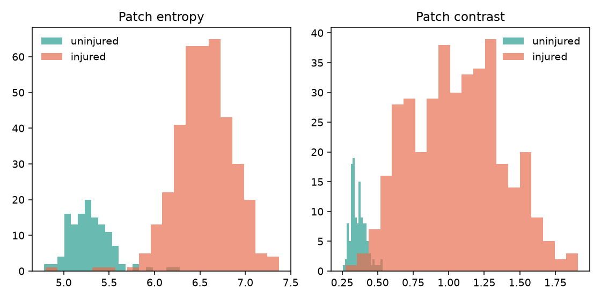
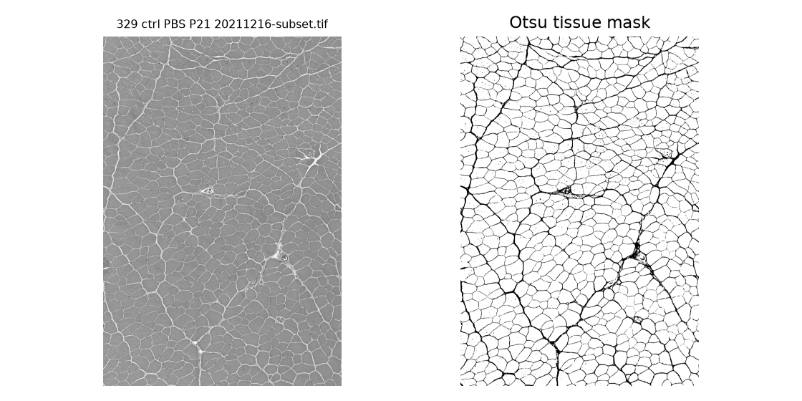

# Brightness texture of injured and uninjured muscle

## Abstract

We compute first-order brightness measures and four Haralick co-occurrence features on four public H&E cross-sections of mouse skeletal muscle. One section is an uninjured PBS control. Three were injured with cardiotoxin. Entropy, uniformity, contrast, homogeneity and energy separate the uninjured section from the injured ones. Neighbor correlation does not: it is about 0.97 on every section. Patches of 512×512 pixels repeat that pattern. One uninjured slide means the numbers describe this set. They are not a diagnostic result.

## 1. Introduction

A brightness histogram throws away where gray levels sit. Co-occurrence keeps one spatial fact: how often two neighboring pixels fall in a pair of bins. Injury can both spread the histogram and make neighbors less alike. Those are different predictions. Entropy can rise while neighbor correlation stays high, if the new gray levels still change smoothly from pixel to pixel. This project measures both, from the histogram and from the co-occurrence counts, on a public H&E set.

## 2. Related work

Gonzalez and Woods define the histogram mean, variance, skewness, uniformity and entropy. Haralick, Shanmugam and Dinstein define contrast, homogeneity, energy and correlation on a gray-level co-occurrence matrix. Contrast weights neighbor pairs by the square of their bin difference. Correlation asks whether a high bin predicts a high neighbor. The two families can disagree, and that disagreement is part of the result.

The sections come from the MyoAnalyst release of Zhang (Zenodo, 2025), stained with hematoxylin and eosin. NCL-SM (Khan et al.) is the corresponding public set of human skeletal-muscle biopsies, healthy and genetically diagnosed. It is distributed as one 5.5 GB archive. This experiment uses the mouse H&E sections because they are the downloadable public set that already labels an uninjured PBS section against CTX-injured sections.

## 3. Approach

Each TIFF is converted to 8-bit brightness. For gray levels z = 0…255,

- mean μ = Σ z p(z)
- variance σ² = Σ (z − μ)² p(z)
- skewness = Σ (z − μ)³ p(z) / σ³
- uniformity = Σ p(z)²
- entropy = −Σ p(z) log₂ p(z), over p(z) > 0

Brightness is quantized to 32 bins for the co-occurrence counts, so a whole section and a 512×512 patch use the same bins. Horizontal and vertical neighbors at distance 1 are pooled into one symmetric matrix. The same nine measures are computed on every non-overlapping 512×512 patch.

Otsu’s threshold was tried as a tissue mask. On these slides the field is already filled with muscle, and the threshold locks onto the dark fiber boundaries rather than onto empty glass. Descriptors therefore use every pixel. The mask figure is kept to show that choice.

## 4. Experimental results

Whole sections, all pixels:

| Section | Condition | Entropy | Uniformity | Contrast | Homogeneity | Energy | Correlation |
|---|---|---:|---:|---:|---:|---:|---:|
| ctrl PBS, day 21 | uninjured | 5.41 | 0.0406 | 0.364 | 0.889 | 0.233 | 0.971 |
| ctrl CTX, day 14 | injured | 6.99 | 0.0113 | 1.398 | 0.745 | 0.030 | 0.976 |
| ctrl CTX, day 21 | injured | 6.67 | 0.0160 | 0.712 | 0.823 | 0.061 | 0.986 |
| ko CTX, day 7 | injured | 6.71 | 0.0139 | 1.082 | 0.723 | 0.042 | 0.967 |

Entropy, uniformity and energy put every injured section on the opposite side of the PBS section. Correlation does not move. Contrast does not tell one story: day-14 CTX is far from PBS, day-21 CTX is closer. The two control-genotype CTX sections already differ from PBS in entropy and energy, so the knockout sample is not required for that gap.

Non-overlapping patches (126 uninjured, 378 injured):

| | Uninjured mean (std) | Injured mean (std) |
|---|---:|---:|
| Entropy | 5.29 (0.23) | 6.55 (0.31) |
| Uniformity | 0.046 (0.006) | 0.018 (0.008) |
| Contrast | 0.36 (0.05) | 1.06 (0.32) |
| Homogeneity | 0.890 (0.011) | 0.763 (0.050) |
| Energy | 0.255 (0.040) | 0.057 (0.025) |
| Correlation | 0.970 (0.006) | 0.971 (0.011) |

Patch entropy and energy barely overlap. Patch contrast overlaps more, because the injured patches are spread out. Correlation overlaps completely. Patches from one section are not independent animals. There is one uninjured biological section.

The right-hand image is the rejected Otsu mask. It traces boundaries. Using it would have measured the dark network and ignored the fiber interiors.

## 5. Conclusion

On these four H&E sections, injury shows up in the mix of gray levels and in local contrast, homogeneity and energy. It does not show up in neighbor correlation. A single co-occurrence feature would have been a misleading summary. The result is tied to this small public set. Repeating the same formulas on NCL-SM would test whether the split survives human healthy-versus-pathology labels.

## References

R. C. Gonzalez and R. E. Woods. *Digital Image Processing*. Histogram mean, variance, skewness, uniformity and entropy.

R. M. Haralick, K. Shanmugam, and I. Dinstein. Textural features for image classification. *IEEE Transactions on Systems, Man, and Cybernetics*, 1973.

B. Zhang. MyoAnalyst: an advanced ImageJ plugin for accurate and automatic myofiber segmentation and analysis in skeletal muscle cross sections. Zenodo, 2025. https://doi.org/10.5281/zenodo.14915567

A. Khan et al. NCL-SM: a fully annotated dataset of images from human skeletal muscle biopsies. https://doi.org/10.25405/data.ncl.24125391
